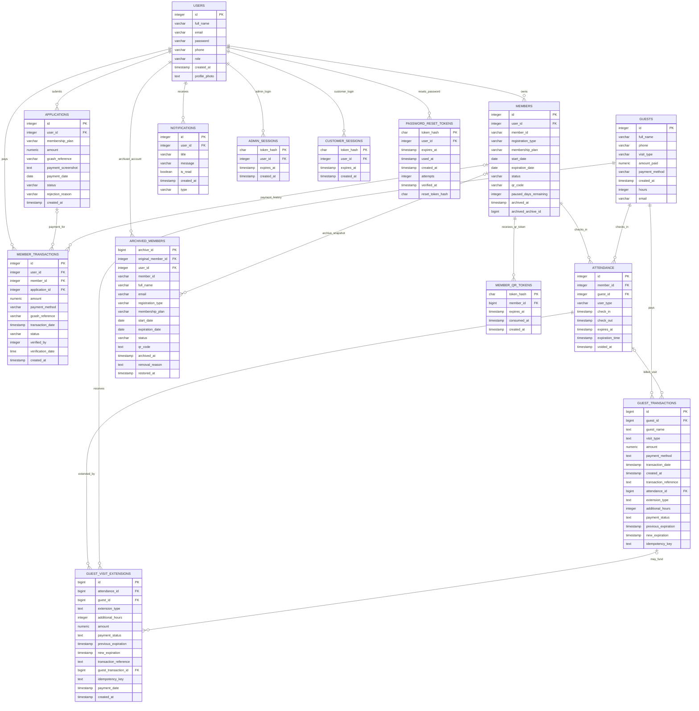

# ANCHOR Gym System Database Design

This document describes the columns visible in the pgAdmin results shared on
2026-10-18 and the application behavior in `backend/server.js`. It is a
logical design overview, not a complete live-schema inspection or a migration.

## Entity-relationship diagram

The diagram shows the application's logical relationships. `PK` indicates the
identifier the application treats as a row key; it does not certify that a
PostgreSQL primary-key constraint exists. A column marked `FK` is used by the
application as a reference. This does not imply PostgreSQL enforces a
foreign-key constraint unless noted in the relationship notes below.

### Relationship and schema notes

- `ATTENDANCE` is polymorphic: a row is for a member or a guest, selected by
  `user_type` and the nullable `member_id` / `guest_id` columns. The design
  should enforce that exactly the appropriate reference is populated.
- The server explicitly declares foreign keys for
  `admin_sessions.user_id`, `customer_sessions.user_id`,
  `member_qr_tokens.member_id`, and `password_reset_tokens.user_id`.
  The other relationships above are logical/application relationships; verify
  actual constraints in PostgreSQL before treating them as enforced.
- The application may rename the legacy `transactions` table to
  `member_transactions`. The column results shared show `member_transactions`.
- The app creates `guest_transactions`, `guest_visit_extensions`, session/token
  tables, and several indexes as part of startup schema setup.
- `users.id` and `notifications.id` were confirmed as `BY DEFAULT` identity
  columns in the pgAdmin results. Other displayed IDs showed sequence defaults.
- The diagram omits some column types' precision and timezone details to keep
  it legible. Use the live PostgreSQL schema as the authoritative source.

## Normalization review

Normalization is assessed from the supplied columns and app code, not from a
complete catalog of primary/unique constraints, foreign keys, triggers, or all
functional dependencies. The column listing does not show primary-key or
unique-constraint metadata. The normal-form comments below are therefore a
tentative structural assessment, not a formal proof that every table meets a
normal form.

### First normal form (1NF)

The listed columns appear scalar and single-valued: for example, a user has one
email per row, and an attendance row stores one check-in/check-out event.
Transactions and attendance are separate rows rather than repeated groups on a
member record. No arrays or comma-separated lists appeared in the columns
shared.

**Review:** The listed structure appears consistent with 1NF, assuming values
such as names, references, and phone numbers are stored as single values.

### Second normal form (2NF)

The application uses single-column identifiers such as `id`, `archive_id`,
and `token_hash`. The supplied column listing does not establish which of
these are primary keys, nor whether there are composite candidate keys. If
each table's candidate key is a single column, there can be no partial
dependency on part of a composite key.

**Review:** 2NF cannot be confirmed from the column listing alone. Confirm the
primary/unique keys and functional dependencies first.

### Third normal form (3NF)

The design separates accounts (`users`), membership lifecycle (`members`),
application decisions (`applications`), visit history (`attendance`), payment
records, and session/token records. This generally keeps attributes with the
entity or event they describe rather than storing all operational data in one
wide table.

**Areas to treat as intentional snapshots or review further:**

- `archived_members` repeats member and user details such as `member_id`,
  `full_name`, `email`, plan, and dates. This can be appropriate for an
  immutable audit/history snapshot, but it is deliberately duplicated data;
  define whether those values represent the member at archive time or should
  track later account changes.
- `guest_transactions.guest_name` and `visit_type` repeat information that may
  also be available from `guests` or `attendance`. If they preserve the
  transaction-time description, document them as snapshots. If they are
  intended to always reflect the current guest record, they introduce update
  anomalies and could instead be obtained by joining the guest/visit tables.
- Membership plan names and amounts appear in multiple business records.
  Keeping the amount on an application/payment is useful as a historical
  charged amount. If plans become configurable, a `membership_plans` table
  could hold current plan definitions while each application retains a price
  snapshot.
- `attendance` has two optional subject references (`member_id` and
  `guest_id`) plus `user_type`. This is a polymorphic design that is harder to
  constrain than separate member and guest attendance tables or a shared
  party/supertype table. At minimum, enforce consistency between `user_type`
  and which ID is populated.
- `applications.payment_screenshot` stores image data in the application
  record. This is not inherently a normalization violation, but a separate
  attachment table or object storage can be preferable for size, retention,
  and access-control reasons.

**Review:** The overall decomposition is sensible and mostly 3NF-oriented, but
3NF cannot be formally confirmed without candidate keys and functional
dependencies. The snapshot fields and polymorphic attendance relationship are
explicit design tradeoffs. Confirm the intended dependencies and database
constraints before making schema changes.

## Suggested validation

Before adding or changing constraints, inspect the live database's primary
keys, unique constraints, foreign keys, checks, and triggers. In particular,
verify:

1. Whether every account has at most one current member record, if that is the
   intended rule.
2. That attendance rows refer to exactly one valid member or guest.
3. That transaction/extension references point to valid source records where
   appropriate.
4. Whether snapshot columns in `archived_members` and `guest_transactions`
   should remain unchanged after the source record changes.

No schema changes are made by this document.
