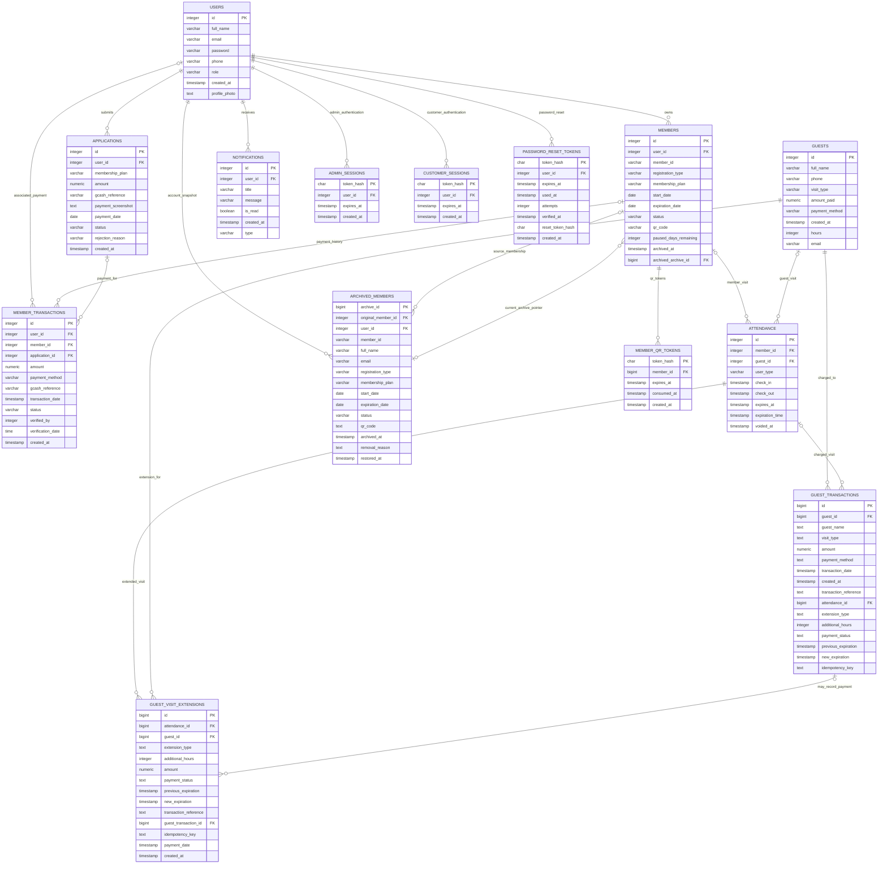

# ANCHOR Gym System — Entity-Relationship Diagram

## Scope and evidence

This is a logical ERD of the 14 database entities used by the project. It was
prepared from the existing database-design documentation and application
queries/schema setup in [`backend/server.js`](./backend/server.js). The
application runs on PostgreSQL.

The repository does not include a live PostgreSQL catalog export or a
foundational migration defining every legacy table. Consequently, identifiers
and relationships used by the application are shown as logical keys where the
physical constraint could not be verified. This diagram does not claim that
all displayed relationships are enforced by PostgreSQL.

## Diagram

## Legend and relationship rules

- `PK`: row identifier treated as the logical primary key by the application.
  It is explicitly declared by the server for `guest_transactions`,
  `guest_visit_extensions`, `admin_sessions`, `customer_sessions`,
  `member_qr_tokens`, and `password_reset_tokens`. For the legacy tables, the
  project documentation/application use the displayed identifier as a row
  key, but this repository does not prove a physical primary-key constraint.
- `FK`: relationship column used by the application. A column label alone
  does not mean PostgreSQL enforces it.
- Crow's Foot notation: `||` = exactly one; `o|` = zero or one; `o{` = zero
  or many. Read each connector from either endpoint. These are logical
  cardinalities based on nullability and workflow; where the physical
  constraint is unknown, they are not a catalog guarantee.
- All listed attributes belong to the entities in the deployed/application
  schema. Exact timestamp timezone modifiers and some legacy column
  constraints are not available in the repository's catalog evidence; verify
  them against PostgreSQL before using this as a physical-schema specification.

### Relationship details and enforcement status

| Relationship | Logical cardinality | What the project evidence supports |
|---|---|---|
| `USERS` — `APPLICATIONS` | One user to zero or many applications; each application belongs to one user | Used by application queries; no FK DDL for this legacy link was found in the server setup |
| `USERS` — `MEMBERS` | One user to zero or many memberships; each member row belongs to one user | Used by membership workflow; no FK DDL for this legacy link was found |
| `USERS` / `MEMBERS` / `APPLICATIONS` — `MEMBER_TRANSACTIONS` | Each transaction may reference zero or one row of each parent; each parent may have many transactions | Application behavior uses these IDs; legacy FK and unique constraints were not established. Approval rejects duplicate transactions for one application in code, but the database uniqueness rule is unverified |
| `MEMBERS` / `GUESTS` — `ATTENDANCE` | Each attendance row is intended for either one member or one guest; each subject may have many visits | Polymorphic reference using `user_type` and nullable IDs. The XOR/consistency rule is an application design requirement, not a verified database constraint |
| `GUESTS` — `GUEST_TRANSACTIONS` | One guest to zero or many transactions; each transaction has one guest | The table creation declares `guest_id NOT NULL`; no FK was declared in the inspected server DDL |
| `ATTENDANCE` — `GUEST_TRANSACTIONS` | An attendance row may have many charges; a transaction may have zero or one attendance | `attendance_id` is nullable; no FK was declared in the inspected server DDL |
| `ATTENDANCE` / `GUESTS` — `GUEST_VISIT_EXTENSIONS` | One attendance and one guest to zero or many extensions; each extension references one of each | Table creation declares both IDs `NOT NULL`; no FKs were declared in the inspected server DDL |
| `GUEST_TRANSACTIONS` — `GUEST_VISIT_EXTENSIONS` | A transaction may relate to zero or many extensions; an extension may have zero or one transaction | Extension `guest_transaction_id` is nullable; the workflow may leave it null for a no-charge extension. No FK/unique rule was declared |
| `USERS` / `MEMBERS` — `ARCHIVED_MEMBERS` | One user may have many snapshots; a snapshot may reference zero or one source member | Archive rows copy profile and membership facts; `original_member_id` is treated as optional lineage. No FKs were declared in the inspected server DDL |
| `ARCHIVED_MEMBERS` — `MEMBERS.archived_archive_id` | An archive row may be pointed to by zero or more member rows; a member row has zero or one current archive pointer | The application sets/clears this pointer during archive/restore; no FK or uniqueness constraint was declared |
| `USERS` — `NOTIFICATIONS` | One user to zero or many notifications | Used by application queries; legacy FK enforcement was not established |
| `USERS` — `ADMIN_SESSIONS`, `CUSTOMER_SESSIONS`, `PASSWORD_RESET_TOKENS` | One user to zero or many records; each record belongs to one user | Server DDL explicitly declares `user_id REFERENCES users(id) ON DELETE CASCADE` |
| `MEMBERS` — `MEMBER_QR_TOKENS` | One member to zero or many tokens; each token belongs to one member | Server DDL explicitly declares `member_id REFERENCES members(id) ON DELETE CASCADE` |

## Notes and unresolved schema questions

1. `ATTENDANCE` is polymorphic. The expected invariant is exactly one of
   `member_id` and `guest_id`, consistent with `user_type`; a check constraint
   or alternative schema is not evidenced here.
2. `members.archived_archive_id` is included because the archive/restore
   workflow writes and reads it. It is a logical pointer; no physical FK was
   found in the server's setup code.
3. `MEMBER_TRANSACTIONS.verified_by` is retained as an attribute but is not
   linked to `USERS`: the repository does not establish its meaning,
   nullability, or FK constraint.
4. `GUEST_TRANSACTIONS.guest_name` and `visit_type`, and the copied
   `ARCHIVED_MEMBERS` profile/membership fields, may be transaction-time or
   archive-time snapshots. They should not be interpreted as live copies
   without confirming the business rule.
5. Existing project documentation provides the legacy table column list;
   backend setup code explicitly defines only some constraints and selected
   support tables. A live catalog export is still needed to certify all
   physical keys, nullability, FKs, checks, indexes, and triggers.
