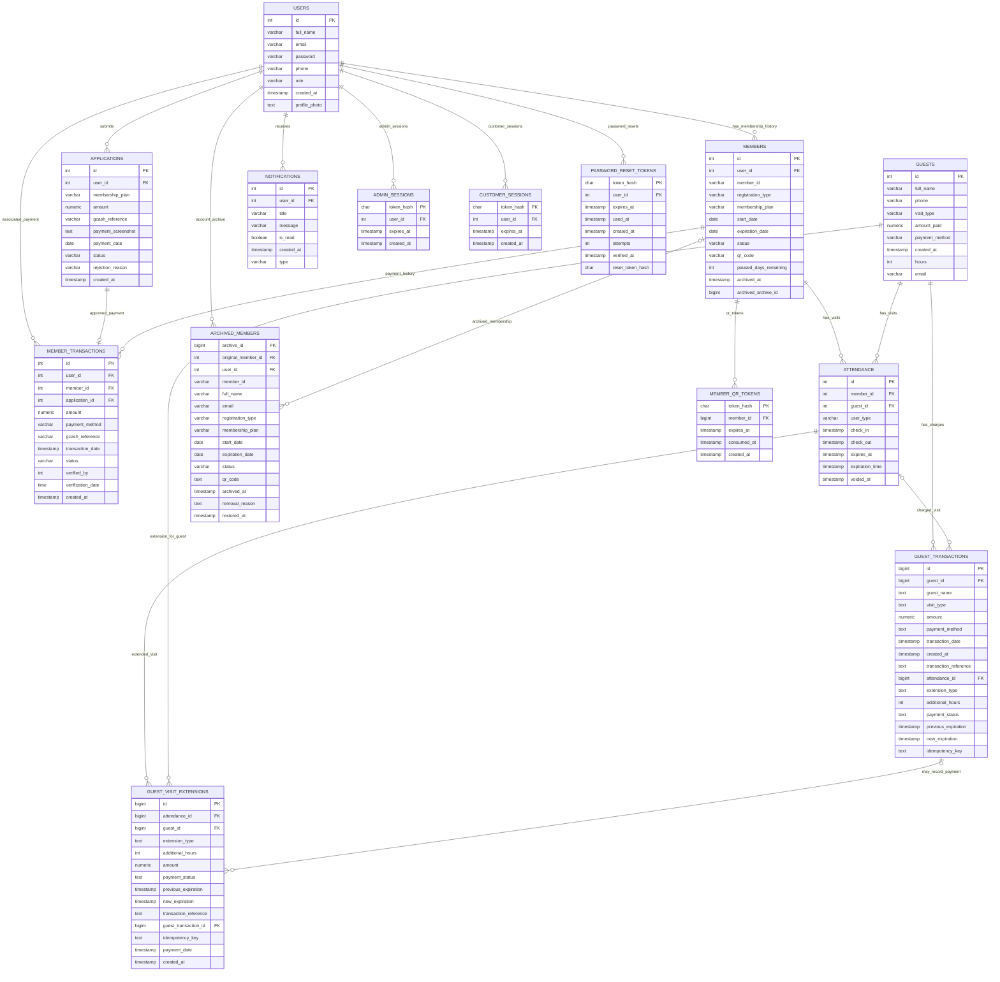

# ANCHOR Gym System
## Formal Logical ERD and Database Normalization

**Scope:** Logical design derived from the pgAdmin column output supplied on
2026-10-18 and the application behavior in `backend/server.js`.

**Important validation limit:** The supplied pgAdmin output lists columns,
types, nullability, defaults, and identity status. It does not include the
database catalog's primary-key, unique-key, foreign-key, check-constraint, or
trigger definitions. Accordingly, this is a **formal logical model of intended
application relationships**, not a claim that all shown keys and relationships
are enforced by PostgreSQL. Confirm those constraints from the live catalog
before applying schema changes.

## 1. Crow's Foot ERD

In the diagram, `PK` denotes the identifier used as the entity key in this
logical model. `FK` denotes a relationship inferred from application usage or
known application setup. These labels do not certify that the corresponding
database constraints exist.

### Cardinality and modeling assumptions

`||` means exactly one; `o|` means zero or one; `o{` means zero or many.

1. An application, member, notification, session, or reset-token row belongs
   to exactly one user in the logical model. The `user_id` columns shown for
   applications, members, and notifications are not nullable in the supplied
   output. The four token/session relationships are also explicitly declared
   as foreign keys by the server's schema setup.
2. A user's applications and membership records are modeled as one-to-many.
   The screenshots do not establish a uniqueness rule limiting the number of
   active memberships per user.
3. A member transaction may be associated with a user, member, and/or
   application; the corresponding columns are nullable in the supplied
   output. The application code rejects approval when it finds multiple
   transaction rows for one application, so the intended application-payment
   relationship is modeled as zero-or-one transaction per application.
   Confirm whether a matching unique constraint exists in PostgreSQL.
4. `ATTENDANCE` is a polymorphic entity: an attendance row represents either
   a member visit or a guest visit, using `user_type` and nullable
   `member_id`/`guest_id`. The intended rule is exactly one valid subject per
   row. This XOR rule was not established by the supplied column listing.
5. `GUEST_TRANSACTIONS.attendance_id` and
   `GUEST_VISIT_EXTENSIONS.guest_transaction_id` are nullable, so the
   corresponding links are optional. A guest transaction may represent a
   visit charge or an extension charge.
6. `ARCHIVED_MEMBERS` contains copied member/account values. Its
   `original_member_id` is nullable, and a live foreign key may not be
   appropriate if the source member row is deleted. Treat it as archive
   lineage/snapshot data unless the application requires a persistent live
   reference.
7. The shared schema lists `member_transactions`; the server supports
   renaming the legacy `transactions` table. Do not model both as separate
   active entities without confirming both exist and have separate purposes.
8. The server explicitly creates foreign keys only for
   `admin_sessions.user_id`, `customer_sessions.user_id`,
   `member_qr_tokens.member_id`, and `password_reset_tokens.user_id` in the
   schema setup inspected. Other ERD links are inferred from app use.

## 2. Normalization analysis

### Key assumptions

The analysis assumes that each displayed `id`, `archive_id`, or `token_hash`
is the intended candidate key for its table. The supplied output confirmed
identity generation for `users.id` and `notifications.id`, and showed
sequence defaults on several other identifiers; it did **not** show PK or
unique constraints. A generated identifier is not automatically a declared
primary key. Before calling the live schema formally normalized, verify all
candidate keys and functional dependencies in PostgreSQL.

### First normal form (1NF)

**Rule:** Each row-column intersection contains one value from the column's
domain; there are no repeating groups.

**Assessment:** The supplied columns appear scalar, and repeated events such
as visits and payments are modeled as separate rows. This is consistent with
1NF based on the information provided. Confirm that text fields such as
`payment_reference` or any future multi-value contact fields do not store
lists of values.

### Second normal form (2NF)

**Rule:** The relation is in 1NF, and every non-key attribute depends on the
whole candidate key, not merely part of a composite candidate key.

**Assessment:** If the assumed single-column identifiers are the only
candidate keys, partial-key dependencies cannot occur, and the relations
would satisfy 2NF. The column listing does not establish candidate keys or
uniqueness, so 2NF is **conditional, not verified**.

### Third normal form (3NF)

**Rule:** The relation is in 2NF, and non-key attributes do not depend
transitively on a candidate key through another non-key attribute. More
formally, for each non-trivial functional dependency `X -> A`, either `X` is
a superkey or `A` is a prime attribute.

**Assessment:** Separating users, membership applications, member records,
visits, payments, and tokens is a sound 3NF-oriented decomposition. The
following areas need explicit business rules before 3NF can be certified:

| Area | Potential dependency or duplication | Recommended treatment |
|---|---|---|
| `MEMBER_TRANSACTIONS.user_id` | If `member_id -> user_id` or `application_id -> user_id`, then a payment's user may be derivable from its member/application. Storing it again can allow inconsistent user references. | Pick the authoritative parent relationship. Retain `user_id` only if transactions can validly exist without member/application linkage or it is an intentional immutable snapshot. Add consistency constraints if multiple references remain. |
| `APPLICATIONS` and `MEMBER_TRANSACTIONS` | Payment amount/reference/status information may appear in both an application and its payment transaction. | Define `APPLICATIONS` as the submitted request/evidence and `MEMBER_TRANSACTIONS` as the financial ledger. Document which fields are snapshots and avoid maintaining two conflicting current values. |
| `GUESTS` and `GUEST_TRANSACTIONS` | Guest profile/payment summary (`amount_paid`, `payment_method`) and transaction data can represent overlapping payment facts. `guest_name`/`visit_type` on a transaction repeat profile/visit data. | Make transaction rows the financial source of truth. Keep copied guest/visit values only as transaction-time snapshots, named/documented as such; otherwise obtain them by joining to the referenced entities. |
| `ARCHIVED_MEMBERS` | Name, email, plan, status, dates, and QR data repeat values from users/members. | This is acceptable when it is a deliberate point-in-time archive snapshot. Preserve snapshot semantics; do not try to keep historical copies synchronized with current profile data. |
| Membership plan labels and amounts | Plan definitions may recur across applications, memberships, and payments. | If plans/prices are centrally managed or change over time, create a `MEMBERSHIP_PLANS` relation. Keep the actual charged amount on the transaction as a historical fact; optionally store a plan/version reference on the application. |
| `ATTENDANCE.member_id` / `guest_id` | A row can potentially reference neither or both subjects, and `user_type` can disagree with the populated ID. | Enforce an XOR/check rule consistent with `user_type`, and add the relevant foreign keys. For a cleaner long-term model, introduce a common `GYM_VISITORS` supertype with member/guest subtype records, or split the two attendance subtypes. |

**Conclusion:** The visible schema is organized in a 3NF-oriented way, but
formal 2NF/3NF certification requires confirmed candidate keys and
functional dependencies. Snapshot fields are not necessarily violations:
they are denormalized intentionally when preserving historical facts.

## 3. Recommended normalized target rules

These are design recommendations, not changes applied to the live database.

1. Declare a primary key on every entity identifier and unique constraints on
   genuine business identifiers (for example, account email and member
   number) after checking for duplicates and confirming the intended rules.
2. Add foreign keys for the relationships that must be referentially
   consistent. Before adding them, find and resolve orphan rows.
3. Enforce attendance subject consistency: exactly one of `member_id` and
   `guest_id` is populated, and it agrees with `user_type`.
4. If one payment per application is a durable business rule, add a unique
   constraint or partial unique index on `member_transactions.application_id`
   for non-null values after checking existing duplicates.
5. Distinguish transaction facts from snapshots. Treat transaction amount,
   method, reference, and status as ledger data; label copied guest/member
   details as snapshots and never silently update historical rows when a
   profile changes.
6. Do not add a plan catalog solely to remove harmless repeated labels. Add
   one if staff need centrally managed plans/prices, and version plan pricing
   so historical applications and payments remain accurate.
7. Consider the polymorphic attendance redesign only as a planned migration:
   define how existing rows map, deploy compatible application code, validate
   data, and retain rollback/back-up options.

## 4. Live catalog verification

Before using this as a physical ERD or implementing migrations, retrieve the
live PostgreSQL definitions for:

- Primary keys and unique constraints for every listed table.
- Foreign keys and their delete/update actions.
- Check constraints, especially attendance subject consistency and status
  domains.
- Triggers that generate identifiers or synchronize copied data.
- Whether `member_transactions.application_id` is unique.
- Whether `members.user_id` or business identifiers such as email/member ID
  have uniqueness rules.

No database modifications are included in this report.
